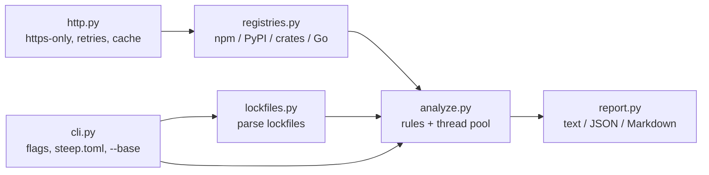

# steep-lock

**Let new releases steep before you drink them.** `steep` audits your lockfiles and flags
dependency versions that are suspiciously fresh, or that shipped *without* the build provenance
earlier releases had. Zero runtime dependencies, one command, four ecosystems.


## The problem

On 2026-10-21 a compromised `litellm 1.107.0` was uploaded to PyPI and was gone within about
two hours ([SafeDep write-up](https://safedep.io/litellm-pypi-compromise-credential-stealer-backdoor/)).
Anyone whose CI resolved dependencies in that window installed a credential stealer. The same
write-up notes that the affected releases had no provenance attestations.

Two cheap signals catch this class of attack:

1. **Cooldown.** Most malicious releases are found and pulled within hours or days. Refusing
   versions younger than N days avoids most of them.
2. **Provenance regression.** A release published *without* attestations by a project whose
   recent releases had them is a strong sign it was not built by the normal pipeline.

Package managers are adding cooldown settings (`uv --exclude-newer`, pnpm `minimumReleaseAge`,
Renovate `minimumReleaseAge`), but each covers one ecosystem, and none tells you what is *already*
in your lockfile or flags the provenance drop. `steep` reads the lockfiles you already have.

## Features

- **Rules:** `too-new` (cooldown), `provenance-regression`, `yanked`, `deprecated`,
  plus informational `not-found` and `lookup-failed`.
- **Ecosystems / files:** npm (`package-lock.json`, `npm-shrinkwrap.json`), PyPI
  (`requirements.txt` pins, `uv.lock`, `poetry.lock`), crates.io (`Cargo.lock`), Go (`go.sum`).
- **PR mode:** `--base origin/main` checks only versions added or changed since a git ref.
- **Output:** text, JSON, or Markdown (for PR comments). Exit code 1 on findings, so it gates CI.
- **Fast & polite:** one request per package, 8 parallel workers, on-disk cache, `--offline` mode.
- **Safe defaults:** HTTPS-only registry URLs (loopback HTTP allowed for testing), no telemetry,
  no credentials needed, packages from git/file/private registries are skipped, not guessed at.

## Install

Requires Python 3.11+.

```bash
git clone https://github.com/Nithinfgs/steep-lock.git
cd steep-lock
pip install .
```

## Quick start

```bash
steep                       # scan every supported lockfile under the current directory
steep package-lock.json     # scan one file
steep --min-age-days 14 --fail-on high
steep --base origin/main    # in a PR: only what this branch added
steep --format markdown > comment.md
```

Real run against the files in [`examples/`](examples) (live registries, 2026-10-21; a 400-day
window is used only so the demo produces findings from old releases):

```console
$ steep --no-cache --min-age-days 400 examples
MEDIUM npm:left-pad@1.3.0  [deprecated]
       release is marked deprecated
       in examples/package-lock.json
checked 8 package version(s): 0 high, 1 medium, 0 low
$ echo $?
1
```

JSON output:

```json
{
  "checked": 8,
  "findings": [
    {
      "package": "npm:left-pad@1.3.0",
      "lockfile": "examples/package-lock.json",
      "rule": "deprecated",
      "severity": "medium",
      "message": "release is marked deprecated"
    }
  ]
}
```

## Rules

| Rule | Severity | Meaning |
|---|---|---|
| `too-new` | high if younger than a third of the window, else medium | Published less than `min_age_days` ago |
| `provenance-regression` | high | No attestations, but one of the 3 previous releases had them (npm, PyPI) |
| `yanked` | high | Yanked in PyPI / crates.io |
| `deprecated` | medium | Marked deprecated on npm |
| `not-found` | low | Version unknown to the public registry |
| `lookup-failed` | low | Network or registry error for that package |

## Configuration

Flags override `steep.toml` (see [`steep.toml.example`](steep.toml.example)):

```toml
min_age_days = 7
fail_on = "medium"            # low | medium | high | never
allow = ["npm:left-pad@1.3.0", "pypi:internal-tool"]
```

Environment variables point steep at a mirror or test server:
`STEEP_NPM_URL`, `STEEP_PYPI_URL` (simple API root), `STEEP_CRATES_URL`, `STEEP_GO_PROXY`.

### GitHub Actions

```yaml
- uses: actions/checkout@v4
  with: { fetch-depth: 0 }
- uses: actions/setup-python@v5
  with: { python-version: "3.13" }
- run: pip install git+https://github.com/Nithinfgs/steep-lock.git
- run: steep --base origin/${{ github.base_ref }}
```

## Architecture



Registry data used: npm packument `time` and `dist.attestations`; PyPI simple JSON API
`upload-time` and PEP 740 `provenance`; crates.io `created_at` and `yanked`; Go proxy `.info`.

## Testing

```bash
pip install -e '.[dev]'
ruff check . && ruff format --check . && mypy && pytest
```

The suite (33 tests) runs the real CLI against a local HTTP server that mimics the four
registries, so it never hits the network. It covers parsers, rules, caching/offline mode, git
`--base` mode, config errors and the https-only guard.

## Limitations

- Go and crates.io expose no provenance data, so `provenance-regression` applies to npm and PyPI.
- Go checks only the age of the locked version, using `go.sum` (which lists transitive modules).
- `requirements.txt` is read only for exact `==` pins. Yarn, pnpm and `Pipfile.lock` are not yet supported.
- A release time is the registry's claim; steep does not verify attestations cryptographically.
- A packument for a very large npm package can be several MB; it is fetched once per package.
- Cooldown trades freshness for safety: urgent security patches may need an `allow` entry.

## Roadmap

1. `pnpm-lock.yaml` / `yarn.lock` / `Pipfile.lock` parsers.
2. Cryptographic verification of npm and PyPI attestations.
3. Maintainer-change and new-install-script detection between versions.
4. SARIF output for GitHub code scanning.
5. A `steep fix` mode that pins to the newest version outside the cooldown.

## Contributing

See [CONTRIBUTING.md](CONTRIBUTING.md). Research and the decision record behind this project
are in [docs/RESEARCH.md](docs/RESEARCH.md).

## License

MIT, see [LICENSE](LICENSE).
